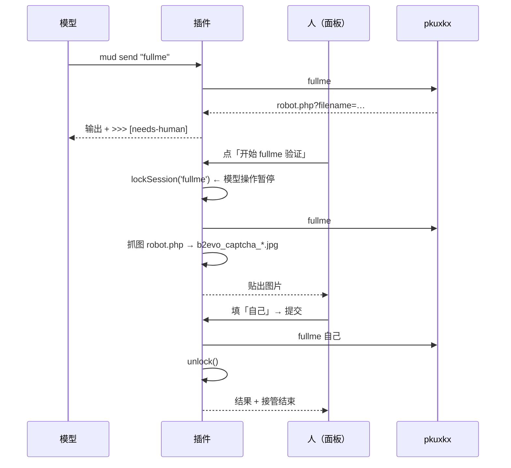
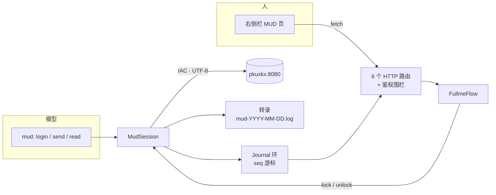

<div align="center">

# 🐱 dsh-tool-mud

**把北大侠客行（pkuxkx）装进 DeepSeek Harness：一条常驻 telnet 会话，一块给人看的面板。**

[](LICENSE)


`mud` 工具 + 右侧栏面板 · 只做终端，不做代练 · 验证码交给人类

**专为 [北大侠客行（pkuxkx）](http://www.pkuxkx.net) 调试** —— 不是通用 MUD 客户端，
登录提示、fullme 验证码、看门狗节奏都是照着这一台服务器写的。

</div>

---

## 一眼看懂

| 模型这边 | 人这边 |
|---|---|
| `mud` 的五个动作：`login` / `send` / `read` / `status` / `close` | 右侧栏 **MUD** 页：日志 · AI 操作 · 下一步 · 日记 |
| 一行一条命令，只读增量回显 | 实时看服务器吐了什么、模型敲了什么 |
| 闲置 3 分钟自动 `save` + `quit` | fullme 验证码点一下，接管会话 |

```jsonc
{ "action": "login" }               // 连接 + 唯一自动的部分：选 UTF-8、填 id / password
{ "action": "send", "text": "hp" }  // 敲一行，返回新输出
{ "action": "read" }                // 只返回上次之后的新输出
{ "action": "status" }              // 连接 / 闲置倒计时 / 人工接管 / fullme
{ "action": "close" }               // 挂断（同时解除人工接管）
```

> **为什么只自动化两件事？**
> 登录要填密码，闲置要下线，这两个不做就是纯粹的人肉折磨；其余每一步都是玩法判断，
> 属于调用方。插件是手柄，不是代练。

---

## 🎯 为什么是 pkuxkx 专用

这个插件不是"通用 telnet 客户端 + 配置文件"，而是**贴着这一台服务器**写的。
下面这些都不是巧合，是踩出来的：

| 地方 | 为什么这么写 |
|---|---|
| `mud.pkuxkx.net:8080` | 官方入口；本机 `getaddrinfo` 会间歇 `ENOTFOUND`，所以额外用 `dns.resolve4` 绕开，兜底 `47.110.45.145` |
| 登录菜单选 `2`（UTF-8） | 服务器开场就问 `Input 1 for GBK, 2 for UTF8, 3 for BIG5`，选错就是乱码 |
| `您的英文名字：` / `请输入您的密码：` | 登录提示表就是这两句中文，按**出现位置**匹配，不是按表顺序 |
| `fullme.pkuxkx.net/robot.php?filename=…` | 验证码的出题接口；图片在 `b2evo_captcha_tmp/*.jpg`，**只认这一套** |
| 闲置 3 分钟 `save` + `quit` | pkuxkx 一个角色只允许一条连接，挂着不退出会把下一次登录顶掉 |
| 中文界面、`>>> [needs-human]` | 面板和提示语都是中文，因为玩的就是中文 MUD |

换一台 MUD 不是改配置就能跑：`src/prompts.js` 的提示表、`src/fullme.js` 的取图逻辑、
`src/session.js` 里 `save`/`quit` 的看门狗，都得跟着换。

---

## 面板长这样

```
┌─ 右侧栏 · MUD ─────────────────────────────┐
│ ● 已连接 47.110.45.145      🐱 人工接管中   │
├────────────────────────────────────────────┤
│ 开始 fullme 验证    需要人眼读图，模型暂停   │
├────────────────────────────────────────────┤
│  日志 │ AI 操作 │ 下一步 │ 日记             │
├────────────────────────────────────────────┤
│ 23:41:07  西大街 -                          │
│ 23:41:07  这里明显的方向有 west、east 和 …  │
│ 23:41:12  模型  look                        │
│ 23:41:13  事件  人工接管：fullme（模型暂停） │
│ 23:41:31  人工  fullme 自己                 │
│ 23:41:32  事件  人工接管结束，模型可以继续   │
└────────────────────────────────────────────┘
```

| 页 | 内容 | 数据来源 |
|---|---|---|
| **日志** | 服务器逐行输出，自动滚到底 | `journal`（`<<` 行） |
| **AI 操作** | 模型敲的命令 + 登录动作 + 连接/闲置/接管事件，带角色标签 | `journal`（`>>` / `event`） |
| **下一步** | 你指定的计划文件末尾 | `planPath` |
| **日记** | 你指定的日记文件末尾 | `diaryPath` |

面板是**纯只读视图**：除了 fullme 的三个按钮（开始 / 提交 / 取消），它不向游戏发任何东西。

---

## fullme：人在环里

验证码是图片，`tesseract` 和视觉模型都试过、都不稳定（见仓库外的实验记录）。所以这里不做求解，只把舞台让出来：



接管期间 `login` / `send` 直接抛错，模型撞上来只会看到一句
`会话已被人工接管（fullme），模型操作已暂停`。四道保险：

- **锁不会比 socket 活得久**：连接断了自动解除接管，不会把人锁在门外；
- **人看图的这几十秒不算“闲置”**：看门狗在接管期间不计数，交还时重置计时；
- **双击只出一张图**：`start()` 单飞，重复点击复用同一个 challenge；
- **取图有超时**：10 秒拿不到验证码页面就解锁报错，不会挂着锁死等。

---

## 安装

插件是标准 cordis 插件包：主机半 + `dsh.client` 声明的浏览器半（手写、无需构建）。

```bash
# 1) 链进 profile
ln -sfn /path/to/dsh-tool-mud ~/.dsh/profiles/web/node_modules/dsh-tool-mud
```

```bash
# 2) 准备账号文件（插件不会自动 chmod，自己收好权限）
mkdir -p ~/.dsh-tool-mud
printf '{"id":"你的英文名","password":"你的密码"}' > ~/.dsh-tool-mud/creds.json
chmod 600 ~/.dsh-tool-mud/creds.json
```

```yaml
# 3) ~/.dsh/profiles/web/cordis.patch.yml
- insert:
    - id: tool-mud
      name: 'dsh-tool-mud'
      config:
        credentialsPath: ~/.dsh-tool-mud/creds.json   # { "id": "…", "password": "…" }
        logDir: ~/.dsh-tool-mud/logs
        planPath: ~/notes/PROGRESS.md                 # 可选：面板「下一步」
        diaryPath: ~/notes/DIARY.md                   # 可选：面板「日记」
```

> ⚠️ 改 `cordis.patch.yml` 会触发 profile 热重载，**正在跑的那条 telnet 连接会一起重建**。
> 想新旧并存：复制一行，把 `id` 和 `toolName` 都改成 `*-dev` / `mud_dev`。

---

## 配置

| 键 | 默认 | 说明 |
|---|---|---|
| `toolName` | `mud` | 工具注册名；改名即可让开发副本与线上副本并存 |
| `host` | `mud.pkuxkx.net` | 服务器 |
| `port` | `8080` | telnet 端口 |
| `encoding` | `utf-8` | 解码方式 |
| `encodingMenu` | `2` | 编码菜单里 UTF-8 的按键 |
| `credentialsPath` | `~/.dsh-tool-mud/creds.json` | 账号文件，`{ "id", "password" }`；**缺失时 `login` 直接报错，不会往游戏里打空行** |
| `logDir` | `~/.dsh-tool-mud/logs` | 每日转录 `mud-YYYY-MM-DD.log`；空串关闭 |
| `fallbackAddresses` | `["47.110.45.145"]` | DNS 失败时的兜底地址（本机 getaddrinfo 会间歇 `ENOTFOUND`） |
| `idleTimeoutMs` | `180000` | 无工具调用多久后下线；**`0` 关闭看门狗**（`status` 报 `watchdog: false`，面板显示“看门狗关闭”） |
| `planPath` | `""` | 「下一步」页的文件；空则隐藏 |
| `diaryPath` | `""` | 「日记」页的文件；空则隐藏 |

路径类配置都接受 `~/` 前缀，会用 `os.homedir()` 展开。

---

## 端点

`ctx.webServer` 上的六个 `exact` 路由，原生 `(req, res)`，全部返回 JSON：

| 方法 | 路径 | 作用 |
|---|---|---|
| `GET` | `/dsh-tool-mud/status` | 连接 / 闲置 / 接管 / fullme 状态 |
| `GET` | `/dsh-tool-mud/journal?since=N` | 游标之后的事件（`seq` 单调递增，`dropped: true` 表示跌出了环缓冲） |
| `GET` | `/dsh-tool-mud/notes` | 计划与日记的文件尾部 |
| `POST` | `/dsh-tool-mud/fullme/start` | 出题 + 取图 + 上锁 |
| `POST` | `/dsh-tool-mud/fullme/submit` | `{ "answer": "自己" }` |
| `POST` | `/dsh-tool-mud/fullme/cancel` | 取消接管 |

自定义路由默认是**公开**的。这些端点能往游戏里打字，所以每个 handler 都套了
`ctx.connection.requestRejection(req)`（Host/Origin + 浏览器 cookie 围栏），
**服务缺失时按 403 拒绝**——失败即放行在这里是不可接受的。

---

## 架构



```
src/
  index.js       Config 默认值 · 工具定义 · 路由注册 + 围栏
  session.js     连接 / 登录 / 发送 / 缓冲 / 看门狗 / 人工接管
  telnet.js      IAC 协商状态机 · ANSI 清理 · 换行归一
  prompts.js     登录提示表 · fullme 识别
  transcript.js  按日转录（密码打码）
  journal.js     面板用的有界事件环
  notes.js       计划 / 日记尾部读取
  fullme.js      人工验证流程（取图 / 提交 / 取消 / 断线中止）
  routes.js      六个 JSON 端点
client/
  index.js       浏览器半包：右侧栏页 + 会话头按钮（手写，无构建）
```

几个踩过的坑，写在这里省得下一个人再踩：

- **telnet 协商是有状态的**：`IAC` 和子协商会被 TCP 切断，半个序列必须留到下一块，否则吞字节；
- **UTF-8 要流式解码**，ANSI 转义跨 chunk 时也要续上；
- **登录提示按出现位置排序**，不是按表顺序——否则 id 和密码会答反；
- **`send` / `login` 串行化**，并发调用不会互相把缓冲 `take()` 掉；
- **连接单飞**，两个 `connect()` 不会开出两条 socket；
- **看门狗 0 即关闭**，不是“立刻踢人”。

---

## 开发

```bash
node --test test/          # 83 个用例，全部离线（假 socket / 假 fetch），约 0.6s
```

`test/wiring.test.js` 需要 DSH 运行时的 `@deepseek-ai/dsh-tools`；裸克隆里没有 `node_modules` 时这 9 个用例会自动跳过，其余照常。

测试不碰真服务器，所以**跑测试不会抢占线上会话**。本地调试同理：别在线上那条连接活着时 `login`，
同一个角色只允许一条连接，新连会把正在玩的踢下线。

想整体验证又不打扰 `~/.dsh`：

```bash
DSH_HOME=/tmp/dsh-scratch dsh web --port 3099
# profile 里把 host 指到 127.0.0.1:9（死端口），任何误点都连不到真服务器
```

---

## 已知限制

- **一条连接一个角色**：插件假设单会话；并发登录会被服务器踢掉（这不是 bug，是 MUD 的规矩）。
- **面板前缀固定为 `/dsh-tool-mud`**：浏览器半硬编码了这个路径，所以它不做成配置项——
  一个客户端学不到的配置只会把整块面板静默 404 掉。
- **转录是一条顺序流**：`journal` 只保留最近 500 条，落后太久会收到 `dropped: true`，长期记录看日志文件。
- **notes 只读尾部**：每次最多读 6000 字（按 mtime 缓存），不是全文。
- **没有内置的“自动玩法”**：路线、任务、战斗判断属于调用方。
- **只对 pkuxkx 负责**：提示语、fullme 接口、`save`/`quit` 都是这台服务器的规矩；
  换 MUD 要改 `prompts.js` / `fullme.js` / `session.js`，不是改配置。

---

## License

[MIT](LICENSE) © 2026 Shirakawa-Kotone
